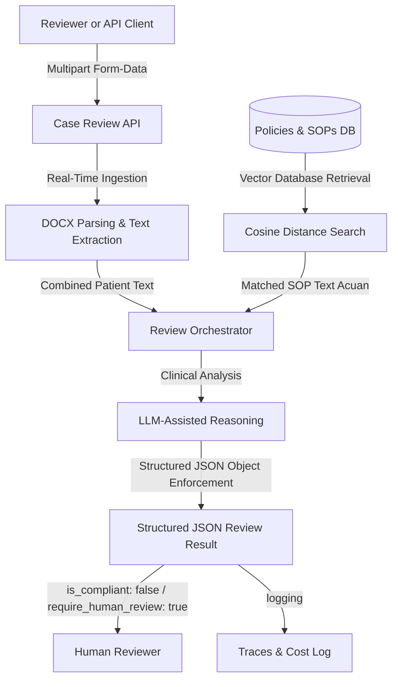

# Architecture

## 1. System Context

### Provider
> This system using provider Google AI Studio to support the system service that need to run an AI model to processing the request.
> Choosing Google AI Studio because it's provide free limited usage to use and run this prototype for technical test.

### Model and Schema
> Use Embedding model to generate vector for SOP document and also for the uploaded patient case.
> Completion or Text Generation use the different model.
> Separate 2 service, 
> - SOP service to generate and store the vector result to database
> - Assistant service to handle patient case file, generate the vector and showing structured format as analyze result.

### Database
> Using postgresql because can easily use pgvector extension to store the SOP vector data.

### Limitation
> Current free plan and free model have limitation: 1500 Request per day, 15 Request per minute.


## 2. Architecture Diagram (Required)



## 3. API Contract

### SOP Service

This service will processing supplied document inside `storage/sop/`. Get text content from document and split as chunk and parsing to vector for each chunk and insert to database.

#### Request
```
curl --location --request POST 'http://localhost:9999/api/sop/generate-sop'
```

#### Success Response | 200
```
{
    "status": true,
    "message": "OK",
    "detail": {
        "status": "Sync_Complete",
        "total_deleted_from_db": 0,
        "total_processed_or_updated": 7,
        "details": [
            {
                "file_name": "SOP-01_required_document_completeness.docx",
                "status": "Extract, Chunking and insert to database successfull",
                "total_characters": 825
            }
            ...
        ]
    }
}
```

#### Failed Response | !200
```
{
    "status":False,
    "message":None,
    "detail":"Error Message"
}
```

### Assistant Service

This service required patient case. Uploaded document will be parsed to vector using embedding and the result will used to find relevant data from SOP.

#### Request
using postman, `files` parameter can be used to upload multiple document for each patient case.
```
curl --location 'http://localhost:9999/api/assistant/review' \
--form 'files=@""' 
```

#### Sample Success Response | 200
```
{
    "status": true,
    "meta_uploaded_files": [
        {
            "filename": "01_registration_form.docx",
            "words": 47
        }
        ...
    ],
    "clinical_review_report": {
        "case_id": "CASE-009",
        "patient_id": "PT-0009",
        "patient_name": "Intan Permata",
        "is_compliant": false,
        "require_human_review": true,
        "missing_documents": [
            "Endoscopy Report (Mandatory per SOP-01 and SOP-05 for procedure 'Colonoscopy', documenting procedure date, findings, and conclusion/impression)",
            ...
        ],
        "inconsistencies_found": [
            {
                "issue_type": "Diagnosis Inconsistency / Uncertainty Escalation",
                "severity": "High",
                "description": "The Claim Submission Form asserts a confirmed diagnosis of 'Acute appendicitis', which contradicts the Discharge Summary where the primary diagnosis is explicitly recorded as 'Abdominal pain - appendicitis not confirmed' and the Attending Physician Note where it is documented as 'Suspected appendicitis' with non-definitive imaging. Under SOP-03 and SOP-06, claiming an unconfirmed or uncertain diagnosis as a confirmed diagnosis is not permitted and requires human review escalation.",
                "evidence": {
                    "claim_submission_form": "Primary Diagnosis: Acute appendicitis",
                    "discharge_summary": "Primary Diagnosis: Abdominal pain - appendicitis not confirmed",
                    "attending_physician_note": "Assessment: Suspected appendicitis. Differential includes gastroenteritis. Imaging not definitive."
                }
            },
            ...
        ]
    }
}
```

#### Sample Failed Response | !200
```
{
    "status": false,
    "meta_uploaded_files": [],
    "clinical_review_report": {
        "case_id": "N/A",
        "patient_id": "PT-0009",
        "patient_name": "Intan Permata",
        "is_compliant": false,
        "require_human_review": true,
        "is_compliant": false,
        "require_human_review": false,
        "missing_documents": [],
        "inconsistencies_found": [],
        "review_summary":""
    }
}
```

## 4. Processing Flow

1. SOP Service need to execute first. That process uncluding read and get the clear text from document, split text into chunks (400 word chunk size and 50 word overlap), 
2. Using results for request embedding to AI Model and store every result with identity of file name and also including the clear text.
3. Avaerage total word for 7 SOP document is under 400 for each. so, total inserted chunk is 7 row.
4. Assistant service used as endpoint to reviewer uploading patient case.
5. Set of patient case document given will be processsed to get clear text of each document, join the text to create complete text.
6. Joined text that contains text of all patient case document will be use for embedding request and get the vector.
7. Vector will be use to query SOP chunk with using method order relevent data and limit top 3 of the relevan.
8. Prepare the prompt for the base rules and including Clear text of patient case also SOP clear text content with the filename included.
9. Final process from Assistant service is request to Text Generation Model with 2 role of messages parameter. 
    - system, that used for tell the model behavior and rules to answer tbe prompt.
    - user, that used for tell the model what user need based on instructions at system role
10. Because instruction include the Structured JSON Format, so the result need to loads into json object and process it as a result.

## 5. AI vs. Deterministic Decisions

Deterministic safer when need a consistent logic, result and validate exact data.

LLM more be justified if need to process unstructured data,  variatif language need to understand the full context and process it to give structured results and context base result.


## 6. Evidence, Uncertainty, and Human Review

Citation/provenance implement in this system based on SOP Document and the Patient Case. while prepare prompt, every relevant text will be pairing with the filename.

Confidence or uncertainty also implemented using the strict instructions. Response will confidence to answer yes or no because every response will based on SOP rules.

Escalation or human review will depends on compliant status and describe why it's needed.

## 7. Reliability, Safety, Deployment, and Cost

RAG keep the response only use the document given. With separating the system prompt and pre-defined user prompt also make safer from prompt injection. But more safe with including additional strict instructions to ignore another prompt injection.

RAG makes cost more efficient because only relevant data that will bring into instructions. But, it will takes more cost on embedding the documents into vector to update vector database. And also need embedding cost to processs patient case document.